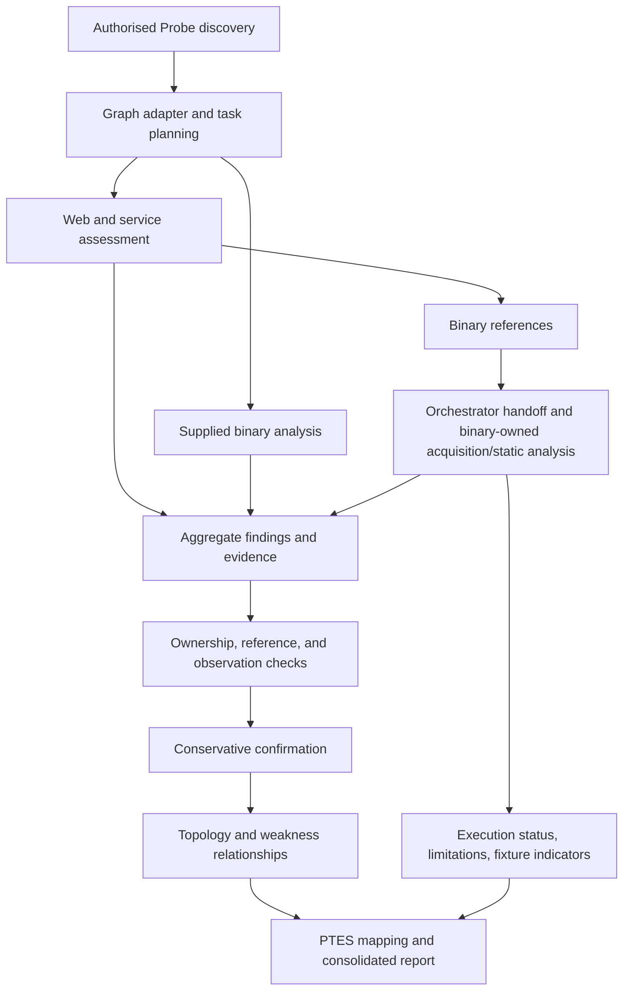

# Pipeline integrity fixes — 2026-11-01

This change addresses independent verification, attack-path, and reporting gaps
identified in the PRD audit. It does not edit the web agent, binary agent,
acquisition, shared schemas, scope configuration, or orchestrator nodes being
worked on separately. No target requests, binary downloads, or authentication
attempts were made for this work.

## Changes

| Pipeline stage | Previous problem | Result |
| --- | --- | --- |
| Evidence validation | A reference could resolve to evidence owned by another finding. Duplicate IDs could hide conflicting records. | Reject foreign ownership and conflicting IDs. Identical records can be replayed. Partial batches retain valid findings. |
| Confirmation | A method label, confidence, and an evidence ID were sufficient for automatic promotion. A description-only placeholder could support confirmation. | Require supplied, owned observation data. Recheck recorded header absence or insecure cookie flags before automatic promotion. Description-only records remain incomplete; they cannot support an already-confirmed finding. |
| Attack paths | A confirmed weakness plus a network connection produced a verified transition. Rejected findings could still become potential attack steps. | Preserve confirmed weakness edges, but infer no verified access transitions. Omit rejected findings from attack paths. A binary credential candidate does not prove access. |
| Consolidated reporting | The discovered-binary result branch was omitted from errors and fixture warnings. Non-completed task statuses without errors disappeared. Evidence-validation limitations were not summarised. | Include the triggered binary branch, execution statuses, fixture indicators, rejected-finding counts, and incomplete-evidence counts. Expose an additive `agent_execution_summary` in JSON. Existing PDF limitations and warnings use the same report data. |

## Current flow



The acquisition/handoff branch belongs to the separate implementation effort.
This diagram describes integration points, not a claim of live end-to-end
validation. Nothing in this change attempts to authenticate using a credential.

## Validation

Run the offline checks with:

```text
python -m pytest tests/test_evidence_validator.py tests/test_pipeline_integrity.py tests/test_reporting.py -q
```

Result: **36 passed** (24 new regression cases and 12 existing tests).
`git diff --check` also passed.

The regressions cover foreign evidence, conflicting IDs in either order, replay,
placeholder observations, contradictory header data, cookie flags, partial
batches, rejected findings, unsupported transitions, binary candidates, triggered
agent limitations, and a producer-to-validation-to-graph-to-report scenario.
They also retain the existing JSON/PDF generation test. No live environment is
used. This is a targeted suite, not a full-suite or live-run claim.

## Remaining integration work

1. Shared task claims, stable deduplication keys, and restart/resume semantics.
2. Preserve application-level discovery metadata through the graph adapter.
3. Include triggered binary tool executions in the orchestrator's PTES collector
   and standardise operation names at their producers. Those nodes remain
   untouched here to avoid overlapping the concurrent work.
4. Establish an explicit transition-proof contract before adding verified access
   edges. Finding confirmation alone must never satisfy it.
5. Distinguish assessment execution completion from discovery completeness and
   address the existing all-skipped completion policy.
6. Add a readable attack-path section to the PDF; its JSON already contains
   attack-path edges.
7. Run a fixture-free integration benchmark against organiser ground truth after
   the separate agent changes are ready.

Reference integrity is not semantic proof for every evidence type. This gate
does not verify arbitrary raw data, referenced artifact contents, or binary
credential provenance. The Binary Analysis Agent remains responsible for SHA-256,
source, offsets/locations, extraction method, and service correlation.
