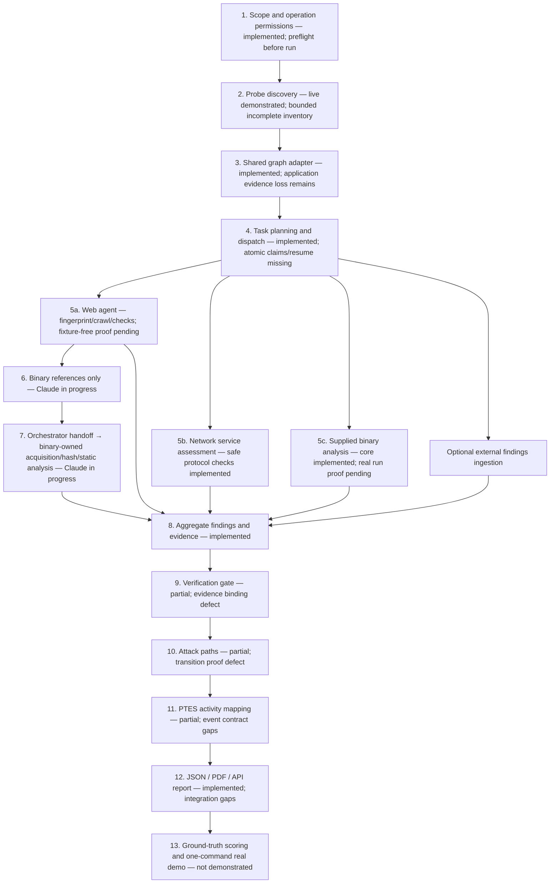

# PRD gap review and delivery pipeline

Snapshot: **2026-10-31T23:52:17+05:30**. Basis: the attached **four-page PRD dated 30 October 2026**, especially functional requirements on page 2 and scoring/setup on pages 3-4.

## Decision

The strongest demonstrated component is live network/service discovery. The remaining delivery risk is proving a real, coordinated network + web + binary assessment with sound evidence and a truthful final attack path. File presence, unit-test success and a synthetic demo are different evidence levels; this review does not equate them.

Existing `docs/IMPLEMENTATION_STATUS.md` compares the project with a separate, much larger master specification. Its dashboard, PostgreSQL, specialised binary-tool and container-architecture gaps are not automatically requirements of this PDF. The PDF permits any implementation approach, calls the named tools suggestions, makes Docker Compose a plus and explicitly does not require a polished UI.

Documents are requirement sources, not instructions to execute target operations. The screenshot records Claude's work plan, not completed acceptance evidence. This review sent no network probes, downloaded no target artifacts and changed no application source.

## Mandatory requirements

| ID | Requirement | Current evidence level | What still needs closing |
|---|---|---|---|
| FR-1 | Find live hosts, open ports and services in scope | implemented-and-live-demonstrated; coverage qualification unmeasured | Bounded discovery remains incomplete; planted-host/service denominator is unavailable. |
| FR-2 | Crawl web apps, list endpoints and flag common issues | partially live-demonstrated | Reviewed consolidated run contains Katana/ZAP fixtures; independent web-capability dispatch and current scope-policy consistency need validation. |
| FR-3 | Inspect supplied binaries for weaknesses | core implemented; discovered-artifact extension in progress | The reviewed consolidated report has no binary findings/evidence. Claude is changing acquisition, raw-byte provenance and no-fixture behaviour. |
| FR-4 | Share findings and hand off work without repetition | partially implemented | One-pass orchestration and task upserts lack atomic leases, stable artifact-based identity and restart proof; Probe application-view evidence is lost at adapter boundary. |
| FR-5 | Map each step to a PTES phase | partial; event-contract defect demonstrated | 33 unmapped activities in reviewed report; producer operation fields mismatch mapper; triggered-binary tool executions omitted by PTES collector. |
| FR-6 | Verify findings rather than only flagging them | partial; evidence ownership defect demonstrated | Evidence ID existence is accepted without finding ownership; unrelated confirmed weaknesses can generate verified access transitions. |
| FR-7 | One report with attack path, simple API/page and README | partially implemented; outputs exist | JSON includes path edges; PDF writer does not render an attack-path section. Newly triggered binary branch is not included in every reporting/provenance collector. |

No overall compliance percentage is assigned. Each row needs its acceptance evidence; treating seven partially demonstrated requirements as seven completed features would be misleading.

## What is actually demonstrated

### Probe and the hidden-service lead

The saved `probe-data/roamer-hidden-verified-20261031/report.json` is a completed bounded live invocation: 241.7 seconds, 174 address/device records, 248 TCP and 27 UDP endpoint observations. The sender and independent auditor both counted 85,780 tagged probes, with zero recorded scope violations. The scope remained `192.168.60.0/24`.

The reusable discovery workflow found the Hidden Wiki at `.139:80` through an explicitly approved forwarding-header test, read its published infrastructure page, extracted the advertised same-host TCP 8833 endpoint and confirmed the Game Zone banner. It did not submit a passkey. No separate backend IP prefix was established. The broader inventory remained INCOMPLETE; this success does not imply that all planted hosts or services were found.

### Existing consolidated assessment

The reviewed saved app report is `evidence/reports/ASSESSMENT-B027905184_report.json`. It contains 44 findings: 11 confirmed and 33 suspected. Its integrity block explicitly reports **Katana and ZAP passive fixtures**. Its evidence types are HTTP responses and ZAP alerts; it does not demonstrate binary findings or binary artifact analysis in that run. Its PTES block contains **33 unmapped activities**.

These are useful integration artifacts, with fixture warnings already present. They are not proof of a fully live three-surface assessment or of the PRD's planted-weakness scores. A confirmed missing-header observation also does not establish a compromise or access transition.

### Implemented application structure

- Probe API/file import and graph normalisation.
- LangGraph orchestration with specialist dispatch, external-finding ingestion, aggregation, validation, graph construction, PTES mapping and reports.
- Web fingerprinting, Katana/ZAP integrations and common-finding templates.
- Safe network-service checks for supported protocols.
- Supplied-binary metadata, static checks and Ghidra integration.
- Assessment/task persistence, JSON/PDF generation, findings/report APIs and a substantial README.

Those components are real source implementations. Their whole-system live acceptance status is narrower than their implementation status.

## Current pipeline

The web-to-discovered-binary branch is present in the changing working tree. It is not yet treated here as a validated, replay-safe queue. The implemented graph has a single handoff stage and a final aggregation path; durable cyclic discovery/work scheduling and checkpoint recovery remain separate work.

## Concrete gaps, ordered by delivery impact

### G1 — Verification and attack-path truth (P0; FR-6, FR-7)

Two local pure-function checks reproduced actual acceptance defects:

1. **Unrelated confirmation can create a verified transition.** In `app/analysis/attack_paths.py:137`, any confirmed finding on host A can create `VERIFIED_TRANSITION` edges to A's structurally connected neighbours. An offline example used only a confirmed missing-header finding and A-to-B connectivity; it still produced a verified transition to B. No access transition was observed.
2. **Evidence ownership is not checked.** `app/analysis/evidence_validator.py:53` validates ID existence but does not require the evidence's `finding_id` to match the citing finding. A confirmed finding citing an evidence object owned by another finding was accepted in the local reproduction.

External findings also receive placeholder evidence rows in `app/api/routes.py`; an allocated ID with no retrievable artifact must not satisfy a strong verification claim.

**Acceptance:** a harmless confirmed configuration issue creates no access transition; only a direct transition observation with matching source/target, operation, assessment, scope and evidence can do so. Mismatched, unavailable, stale or tampered evidence is rejected or explicitly unresolved. Store hashes and provenance where actual artifacts are available. Keep observation, suspected weakness, verified weakness and verified access transition distinct.

### G2 — A fixture-free real run across all three surfaces (P0; FR-2, FR-3, FR-6)

The saved consolidated run uses fixtures. `app/core/config.py` enables web and binary fixture fallbacks by default; Compose enables them too. The discovered-artifact branch being implemented by Claude explicitly avoids canned Ghidra output, which is an improvement, but the supplied-binary path and shared reporting still need consistent handling.

**Acceptance:** a real-run profile disables fixtures before starting. Missing tools produce an explicit incomplete result rather than synthetic findings. One permitted lab run produces real web endpoint/check evidence, real network-service observations and actual binary-byte/static-analysis evidence, all in the same assessment. A strings-only analysis is a valid limited observation; it must describe its limits and never imply a decompilation or a successful credential test.

### G3 — Preserve discoveries across the Probe → app boundary (P1; FR-4, FR-7)

`ProbeAPISource` currently reads hosts and segments. `normalise_probe_graph` derives graph edges from segment `via`; service normalisation retains basic service/product/banner fields. It does not import Probe's new application-view edges, HTTP resource metadata and detailed scope/method evidence as first-class shared observations. The main assessment can therefore lose the very evidence that explained the Hidden Wiki.

The reviewed app report also contains many web-origin policy rejections. A broad discovered inventory and a narrower assessment policy must produce a visible coverage explanation, not the impression that every discovered web service was assessed.

**Acceptance:** importing the live `.139` result preserves both endpoint identities, the wiki resource/source information, the reference to 8833, the observed banner, evidence provenance and the relevant permission context. An imported discovery is data; it must not grant a worker permission to replay a sensitive method. Preserve run ID/freshness and exact scope separately from inventory content.

### G4 — Replay-safe handoffs and a fresh one-command assessment (P1; FR-4 and autonomy)

The application database stores task statuses through `upsert_agent_task`; it does not expose atomic claim/lease/reap semantics. Probe's separate task ledger does not automatically supply those guarantees to `app/`. The current discovered-binary task ID includes the reference's list index, making reordered or duplicated references an important replay case. The LangGraph graph compiles without a checkpointer.

Probe can be read over its API, with `ensure_scan` available but off by default. Compose expects Probe to be launched separately. Environment installation is a legitimate prerequisite, but the final judge-facing assessment must have one repeatable entry point that verifies readiness and obtains an appropriately fresh inventory.

**Acceptance:** duplicate references, reordered references, retry and crash/restart do not cause duplicate acquisition/analysis. Use stable work identities and durable claims/results. A one-command launcher performs preflight, starts or contacts Probe, obtains a fresh authorised snapshot, dispatches eligible work, waits for completion or recorded limits and exports reports. Pre-authorise permitted methods before the timed run; discovering a resource never expands authorisation.

### G5 — Complete PTES event mapping and the new branch's integration (P1; FR-5)

Many web tool executions omit `operation`/`op`, while `ptes_mapper` matches `(tool, operation)` pairs. The reviewed report has 33 unmapped events. A local reproduction with the current event shapes reproduced the mismatch.

`nodes.map_ptes_phases` gathers ordinary web, supplied-binary and network-service results, but omits `triggered_binary_agent_result`. The report generator's fixture/incomplete-task collectors also enumerate only the older result groups. The binary acquisition tool/operation pair requires a defined phase mapping too.

**Acceptance:** standardise the tool event contract; collect every result branch; include discovery, acquisition, analysis, permitted verification and reporting activities. Avoid filling unused PTES phases with fictional actions. All executed actions map correctly or carry a visible unresolved mapping.

### G6 — Report parity, completeness and lifecycle control (P1; FR-7)

JSON includes `attack_paths`; the PDF writer currently renders summaries, scope, methodology, findings, PTES and limitations without a dedicated attack-path section. A report field in JSON does not establish PDF parity. The report collectors need the new binary branch's limitations and provenance.

`complete_assessment` can mark an assessment completed when every task was skipped. Execution completion and required-surface coverage need distinct representations. The dispatcher returns on timeout but cannot stop an already-running worker thread; run completion must not silently leave target actions running.

**Acceptance:** matching JSON/PDF/API inventories, findings, evidence, PTES and attack paths; required missing/skipped surfaces visibly incomplete; fixture and truncation limitations preserved. Termination/cancellation has bounded worker and subprocess behaviour. A report never promotes a hypothetical path into demonstrated access.

### G7 — Scope safety across every worker (P1; mandatory goal and scoring)

Probe has live guard/auditor/egress evidence. The application's web/binary/network workers use a different policy model based on asset IDs and approved origins. The independent Windows Nmap rules do not cover httpx, Katana, ZAP or binary acquisition. Katana output is filtered after the subprocess runs; that alone does not prove the child never contacted an out-of-scope resource.

**Acceptance:** one immutable authorisation envelope is traceable across workers. Negative tests cover foreign redirects, child-tool crawling, DNS/origin changes, held assets, unapproved methods and discovered artifact URLs. Verify enforcement before sending; record the worker/tool scope result in the final run. A particular database or container product is not prescribed by the PRD; the required property is no out-of-scope activity.

### G8 — Measure against planted ground truth (P1; scoring qualification)

The denominator is the organisers' planted hosts, services and weaknesses, not all addresses to which Probe sent packets. We have no checked ground-truth manifest or selected-tier benchmark record in this review. There is no justified percentage for coverage, finding recall or false positives yet.

**Acceptance:** a permitted scoring manifest and repeatable comparison record host/service recall, planted-weakness recall, verified fraction, false-positive fraction, scope violations, elapsed wall time and human interventions. Exclude fixture results from live scores. Scope approvals provided before the run are setup; new approvals requested during the run count as interventions when evaluating the Great autonomy target.

## Claude's current work and ownership boundary

The screenshot's items align with the changing files: web reports references; binary owns acquisition/hash and static analysis; discovered artifacts avoid canned fallback; findings retain provenance and service correlation; orchestration hands off references; tests show binary analysis without console authentication. New files and tests are appearing during this audit.

Treat this as **in progress**, not missing work to duplicate and not accepted solely because the files exist. The binary branch is an extension of FR-3/FR-4 needed for this live lab flow; the original FR-3 literally asks for inspection of the binaries supplied at kickoff.

Independent follow-up can focus on G1, G3, G5-G8. Coordinate before editing `nodes.py`, `schemas.py`, scope guard or the binary/web files because Claude is actively changing them. This audit changed only review artifacts and retained its code-snapshot hashes in `prd-requirement-matrix-2026-10-31.json`.

## Suggested delivery order and stop conditions

| Step | Deliverable | Definition of done | Dependency |
|---|---|---|---|
| 1 | Freeze assessment contract and evidence snapshot | Stable input scope, selected tier, tool versions, policy, required surfaces and fixture-free profile recorded | Organiser inputs and current Claude interface |
| 2 | Evidence/transition gate corrections | G1's negative reproductions pass and positive transition evidence remains representable | Shared schemas |
| 3 | Finish Claude's web → binary branch | Real artifact reference/acquisition/hash/static findings, no invented bytes and no AUTH attempt | Step 1 |
| 4 | Integrate discovery evidence and reliable task identity | Probe application observations survive adapter import; duplicate/restart tests pass | Steps 1 and 3 |
| 5 | Close event/report/scope gaps | G5-G7 acceptance checks; JSON/PDF/API parity with explicit incomplete states | Steps 2-4 |
| 6 | Run a real all-surface assessment | One command, no fixture tools, complete audit trail, no mid-run manual routing of tasks | Steps 1-5 |
| 7 | Compute PRD scores | Ground-truth comparison and selected-tier timing/human-step results | Step 6 + organiser truth |
| 8 | Choose a bonus | Only after required qualification evidence is retained | Step 7 |

No extra dashboard or architecture rewrite is needed to start closing these acceptance gaps.

## PRD scoring checklist

| Measure | Good | Great | Current defensible status |
|---|---|---|---|
| Planted hosts/services found | Over 70% | Over 90% | Unknown without ground truth; 253 probed targets is not recall |
| Planted weaknesses found | Over 60% | Over 85% | Unknown; missing real all-surface validation |
| Findings verified | Half | All | Reviewed report labels 11/44 confirmed, but contains fixtures and ownership/path defects; not a qualified score |
| False alarms | Under 30% | Under 10% | Unknown without planted/independently labelled truth |
| Scope safety | At most one stray probe | None | Demonstrated for the recorded Probe run; complete multi-agent run not yet independently demonstrated |
| Full-tier run time | Under 1 hour | Under 20 minutes | Probe is 241.7 seconds; full live three-surface tier run unmeasured |
| Autonomy during assessment | Starts with one command | No human input | API entry exists; fresh, real, complete workflow not yet demonstrated; earlier header approval was a human intervention |

The difficulty tier is also unrecorded here. Recon/Breach/Deep have different lab scale and multipliers; select the tier before interpreting a runtime or coverage result.

## Optional bonuses

| ID | Bonus | Status |
|---|---|---|
| B-1 | Planted flags | not demonstrated in reviewed evidence; optional |
| B-2 | Verified crown-jewel chain | not demonstrated; potential graph edges are insufficient; optional |
| B-3 | Plain-English remediation | implemented for supported finding templates; completeness not measured; optional |
| B-4 | New agent/check from configuration alone | not demonstrated; routing and checks are primarily code-defined; optional |
| B-5 | Live multi-agent dashboard | not implemented as a unified live view; Probe UI and task-status API exist; optional |

A confirmed crown-jewel path and planted flag capture need their own permitted evidence; they must not be inferred from graph connectivity, a banner saying 'flag', or a recovered string.

## Review evidence and limitations

- Original source: `../../../PRD_Autonomous_Pentest_Engine.docx.pdf`, all four pages extracted and visually inspected.
- Pure-function reproductions: `../../probe-data/prd-audit-20261031/reproductions.json`.
- Component live proof: `../../probe-data/roamer-hidden-verified-20261031/report.json` and `hidden-services-report.md` in that directory.
- Reviewed consolidated report: `../../evidence/reports/ASSESSMENT-B027905184_report.json`.
- Source/evidence hashes, per-requirement acceptance criteria and snapshot time: `prd-requirement-matrix-2026-10-31.json`.
- Diagram source: `current-delivery-pipeline.mmd`.

No full suite was run against Claude's changing working tree, and no earlier component test count is presented as full-system acceptance. Recheck the affected rows after Claude's branch stabilises. The offline reproductions demonstrate current logic defects; they do not establish vulnerabilities in any target system.
